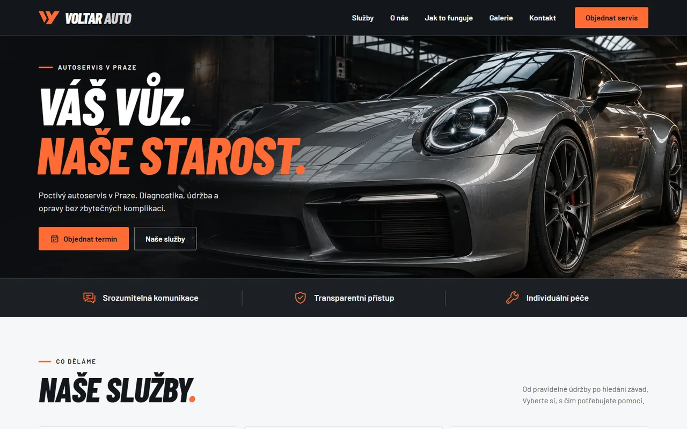

# VOLTAR AUTO

Ukázka webu pro fiktivní pražský autoservis VOLTAR AUTO. Prohlédněte si služby a galerii dílny nebo si vyzkoušejte poptávkový formulář bez odesílání údajů.

**[Otevřít živou ukázku](https://biarkvia.github.io/voltar-auto/)**

[](https://biarkvia.github.io/voltar-auto/)

## Local development

Use Node.js 24 LTS and npm. From the directory containing this README, run:

```sh
npm install
npm run dev
```

Open the local URL printed by Astro, normally `http://localhost:4321`. For repeatable installs from the committed lockfile, use `npm ci`.

| Command | Purpose |
| --- | --- |
| `npm run dev` | Start the development server with live reload |
| `npm run check` | Check Astro components and strict TypeScript |
| `npm run build` | Compile the production site into `dist/` |
| `npm run preview` | Serve the last production build locally |

## Stack and structure

Astro 7, strict TypeScript, semantic HTML and mobile-first CSS. Astro Image and Sharp generate responsive WebP variants at build time. Barlow and Barlow Condensed are bundled with Fontsource. Navigation, gallery and form enhancements run in the browser without a client-side framework.

| Location | Editable content |
| --- | --- |
| `src/data/site.ts` | Name, slogan, description, demo flag, navigation, services, benefits, process and contact details |
| `src/components/` | Individual page sections, original brand mark and service icons |
| `src/styles/global.css` | Colour palette, typography, layout, breakpoints and interaction states |
| `src/assets/images/` | Local source images |
| `src/scripts/inquiry.ts` | Form submission boundary |
| `src/layouts/BaseLayout.astro` | Metadata, social preview and canonical URL |
| `src/pages/` | Home page, robots.txt and conditional sitemap content |

Selecting a service card preselects its service in the enquiry form. The mobile navigation supports keyboard activation and Escape. Each gallery thumbnail also links directly to its larger image. With JavaScript enabled, the gallery opens in a native dialog with previous/next controls, left/right arrow keys and Escape.

## Demo mode and privacy

`site.isDemo` defaults to `true`. The footer identifies the fictional business, the form explains its purpose before submission and the document contains `noindex, nofollow`. No business structured data, reviews, street address or telephone number are supplied. The fictional contact fields are empty. No analytics, cookies, local storage or external form services are used.

The form checks the required name, email and message fields. Errors appear beside the corresponding inputs and the first invalid field receives focus. Valid entries display the Czech message *Toto je ukázkový formulář. Žádné údaje nebyly odeslány.* Values exist only in the current page. The HTML form uses `method="dialog"` and a disabled submit button until initialization, so it cannot fall back to transmitting values in a URL when JavaScript is unavailable.

In demo mode, `robots.txt` permits crawlers to read the page-level indexing directive and the sitemap contains no URLs. In production mode, supplying a site origin adds the home page to the sitemap and advertises it in `robots.txt`. Sitemap content is generated during the build.

## GitHub Pages

The public demo is hosted at [biarkvia.github.io/voltar-auto](https://biarkvia.github.io/voltar-auto/). A push to `main` runs the type check, builds the site and deploys the resulting `dist/` directory. The workflow reads the origin and subdirectory from the Pages configuration. For a fork, select **GitHub Actions** under **Settings → Pages → Build and deployment**.

## Deploy on Vercel or Netlify

1. Put this project in a Git repository with its lockfile. Import the repository into the hosting provider. If the repository contains a parent folder, select the directory containing `package.json` as the project root.
2. Choose the Astro preset on Vercel or a static site on Netlify. Use Node.js 24, the build command `npm run build` and the output directory `dist`. A server adapter is unnecessary for this project.
3. Set the build environment variable `SITE_URL` to the absolute HTTPS origin of your deployment. This enables absolute canonical, Open Graph and production sitemap URLs. For local builds, copy `.env.example` to `.env` and edit the origin. Without it, the site still builds and omits the canonical tag.
4. Deploy, then open the site and try the demo form. Keep `isDemo: true` for a portfolio deployment.

The generated `dist/` directory can also be uploaded to a static host. Set `SITE_BASE_PATH` if it will be served under a subdirectory, such as `/voltar-auto`. The default is the domain root.

Provider documentation: [Astro on Vercel](https://docs.astro.build/en/guides/deploy/vercel/), [Astro on Netlify](https://docs.astro.build/en/guides/deploy/netlify/).

## Connecting a real enquiry service

For a real client, edit the contact data and replace the non-demo branch of `submitInquiry` in `src/scripts/inquiry.ts`. The function receives the validated `FormData` with keys `name`, `email`, `phone`, `service` and `message`.

Use that branch to call a Formspree endpoint, a configured Netlify Forms endpoint or a same-origin API. For Netlify Forms, also enable detection and provide the form name, hidden form-name field and static provider markup before deploying. Check the response before returning a success message and throw on failure so the existing form UI can show an error. Preserve the demo return before any network call. Keep service secrets on the server and validate submissions there. The existing controls, errors and accessible status region can be reused.

Switch `isDemo` off only when the content and submission flow are ready for the real business. Switching the flag alone shows an unavailable message on submit. Set the new production origin and rebuild.

## Media and licences

The garage hero is an original AI-generated image made for this project with OpenAI ImageGen. The six workshop photographs are local copies licensed under the Pexels License. Filenames, photographer credits and original links are in [IMAGES.md](IMAGES.md). These images illustrate the fictional service.

Barlow and Barlow Condensed are distributed under the SIL Open Font License 1.1. Copyright notices and the full licences ship in `public/licenses/` with the deployed site. The logo, favicon and line icons are original SVG artwork for VOLTAR AUTO.
